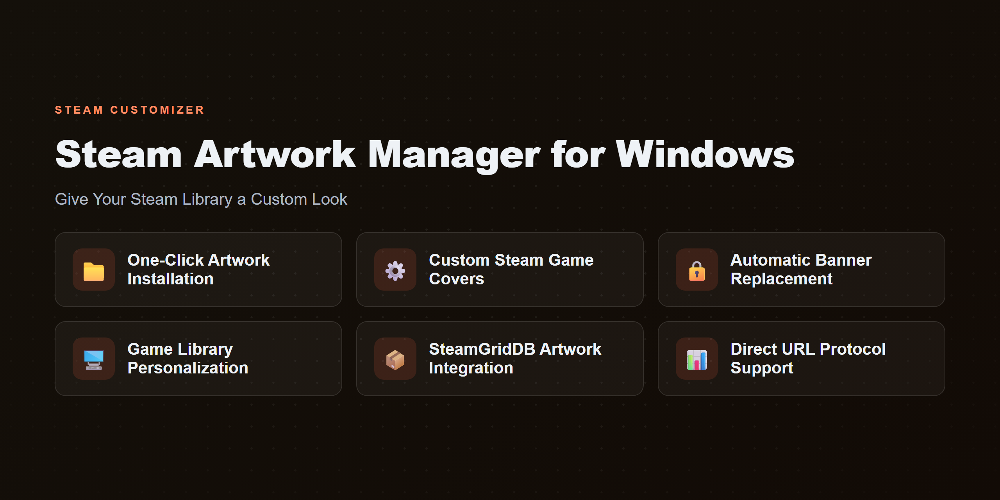
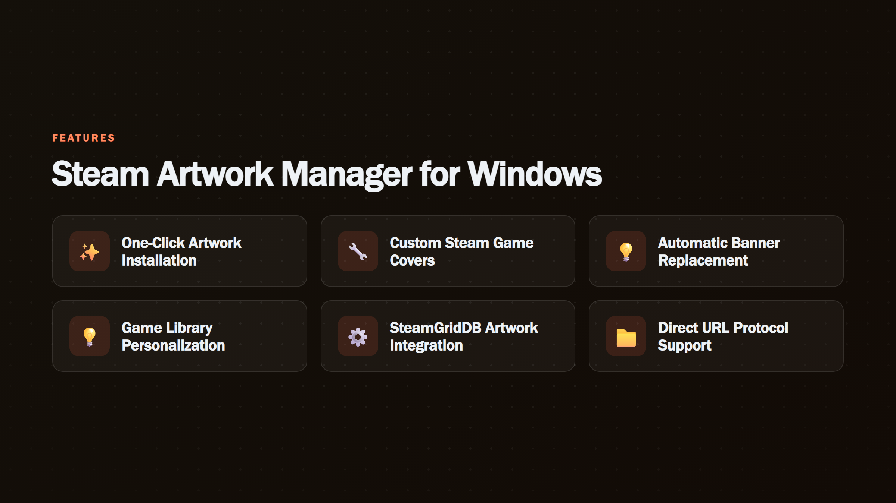

**Transform your Steam library with beautiful custom artwork.**

**Steam Artwork Manager** is a free, open-source Windows desktop utility for personalizing your Steam game library with custom covers, banners, icons, and other artwork from SteamGridDB. Find artwork you love and apply it directly to Steam without manually downloading files or using command-line tools.

## ⬇️ Installation

**Download the Windows application**

1. Open the repository's [Releases](https://github.com/Zephyr9668-byte/steam-artwork-manager/releases) page.
2. Download the latest release archive **`Steam Artwork Manager for Windows 4.1.5.zip`**.
3. Extract the archive into a folder of your choice.
4. Keep **`Steam Artwork Manager for Windows 4.1.5.exe`** and `libvlc.dll` together in that folder.
5. Double-click **`Steam Artwork Manager for Windows 4.1.5.exe`** to launch the application.

## ✨ Features

- 🎨 **Custom Steam Game Covers** — Replace default game artwork with high-quality custom covers and vertical library images.
- 🖼️ **Personalized Library Banners** — Give your Steam collection a consistent visual style with custom horizontal artwork and backgrounds.
- 🚀 **One-Click Artwork Installation** — Apply selected artwork directly to your Steam library without repetitive manual file operations.
- 🌐 **SteamGridDB Integration** — Connect your customization workflow with a large collection of community-created Steam game artwork.
- 🎮 **Complete Game Library Customization** — Improve the appearance of individual games and make your Steam collection feel uniquely yours.
- ⚡ **Automatic URL Handling** — Use supported artwork links to launch the application and process customization requests conveniently.
- 🆓 **Free and Open Source** — Enjoy a lightweight desktop utility without subscriptions, paid features, or unnecessary software overhead.

## 🖼️ Overview

Explore a streamlined workflow for applying community-created artwork to your Steam game collection.

### Supported artwork categories

| Artwork type | Purpose |
|---|---|
| Game covers | Customize library cover images |
| Wide artwork | Personalize horizontal game banners |
| Hero images | Enhance individual game presentation |
| Game icons | Replace default game icons |
| Library artwork | Create a consistent visual experience |

Artwork availability depends on the selected game and the assets provided by the community.

## 🚀 Usage

Getting started with Steam library customization is straightforward.

1. **Launch the application** — Open Steam Artwork Manager on your Windows desktop.
2. **Explore SteamGridDB** — Visit the artwork collection and find the game you want to personalize.
3. **Choose your artwork** — Select a suitable cover, banner, icon, or other available image.
4. **Activate the artwork action** — Use the supported artwork application link to send your selection to the desktop utility.
5. **Apply your customization** — Let the application process the request and update the corresponding Steam artwork.
6. **Check your Steam library** — Open Steam and enjoy your refreshed game collection.

### 💡 Customization tips

- Choose artwork with consistent dimensions for a cleaner library layout.
- Experiment with different cover styles to create a unified visual theme.
- Use high-resolution community artwork when available.
- Restart or refresh Steam if an artwork change is not immediately visible.

## 🪟 Windows Desktop Integration

Steam Artwork Manager is designed to make the connection between online artwork collections and your local Steam installation convenient.

Its URL-handling workflow allows supported links to be passed directly to the desktop application instead of requiring users to download and organize every image individually.

**Designed for:**
- Windows desktop and laptop users.
- Steam gamers who enjoy library customization.
- Steam Deck owners managing their Steam artwork through a Windows PC.
- Users who prefer graphical desktop applications over manual file management.
- Gaming enthusiasts building visually consistent Steam libraries.

## 🔒 Security & Privacy

Your desktop customization tools should remain transparent and trustworthy.

- **Open-source software:** The source code can be inspected and independently audited.
- **No unnecessary telemetry:** The application is designed around its artwork-management functionality rather than user tracking.
- **No advertising requirements:** Customize your Steam library without needing an advertising-supported workflow.
- **Local desktop integration:** Artwork application involves interaction with your local Steam environment.
- **Permission awareness:** Only grant elevated permissions when required by the installation or registration process.

### Reporting issues

Encounter a problem with artwork application, Steam integration, or URL handling?

Please report reproducible issues through the repository's GitHub Issues section. Include:

- Your Windows version.
- Your Steam installation environment.
- A description of the issue.
- Steps to reproduce the problem.
- Relevant error messages or diagnostic information.

Never include passwords, access tokens, or other private account information in issue reports.

## ❓ Frequently Asked Questions

### Is Steam Artwork Manager free?

Yes. The application is intended to be free and open-source software.

### Do I need to download artwork manually?

No. Its primary purpose is to simplify applying artwork from SteamGridDB without the usual manual download-and-replace workflow.

### Does it work with Steam?

Yes. The application is designed specifically to integrate with the Steam desktop library and apply supported artwork customizations.

### Can I customize multiple games?

You can repeat the artwork selection and application workflow for different games in your Steam library.

### Does it replace Steam?

No. This is a companion desktop utility. Steam remains responsible for managing and launching your games.

### Is it useful for Steam Deck owners?

Yes. You can use a Windows PC to customize artwork associated with your Steam library and enjoy those changes in supported Steam environments.

## 🛠️ Technology

The application is built in C, with an emphasis on lightweight desktop functionality and direct integration with the operating system.

| Component | Purpose |
|---|---|
| C | Core application implementation |
| Windows integration | Desktop execution and URL handling |
| Steam integration | Local library artwork customization |
| SteamGridDB | Community artwork discovery |
| URL protocol | Convenient link-to-application workflow |

## 🌟 Why Customize Your Steam Library?

Steam's default library presentation is functional, but custom artwork makes a collection much more personal.

Whether you maintain a small collection of favorite games or hundreds of titles, personalized covers and banners can help create a cohesive, visually appealing gaming library.

Steam Artwork Manager brings the artwork discovery and application process together in one lightweight Windows desktop tool.

## 📄 License

This project is distributed under the **MIT License**.